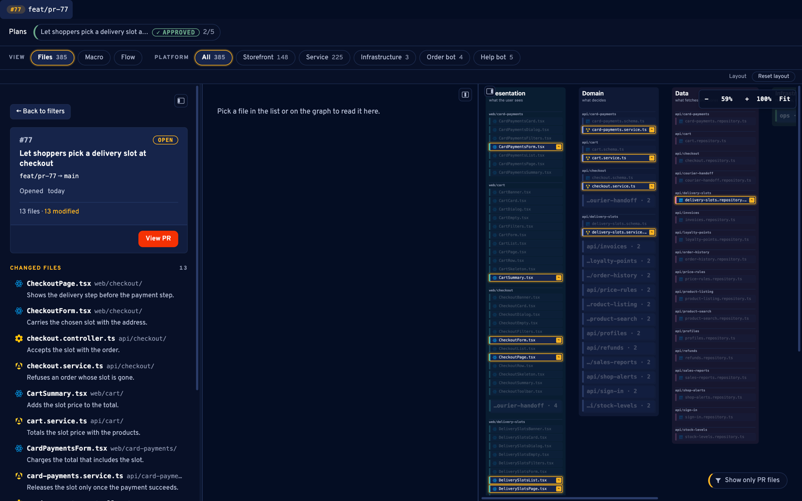
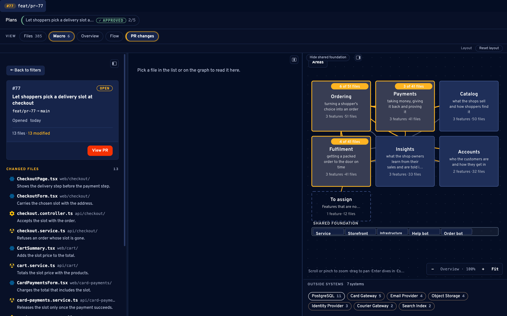
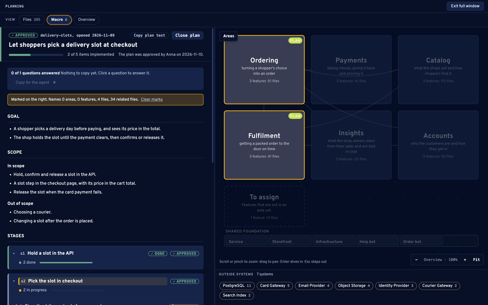
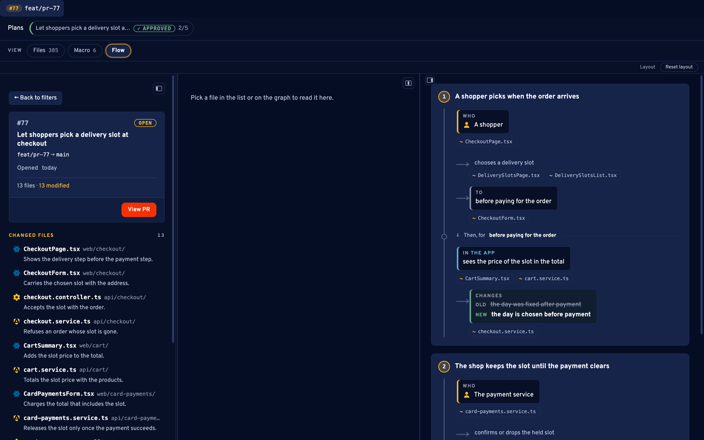
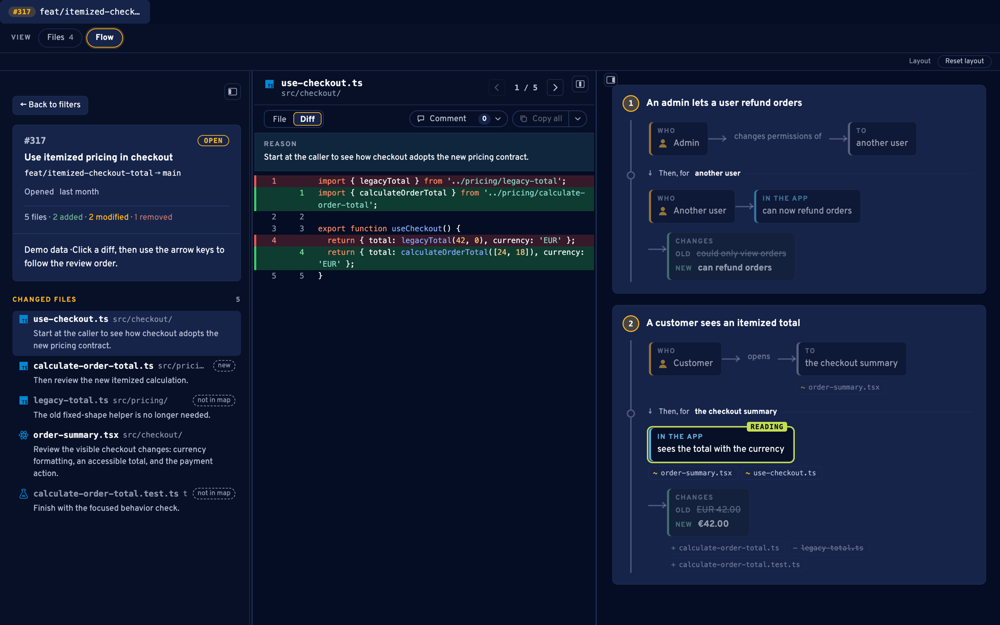
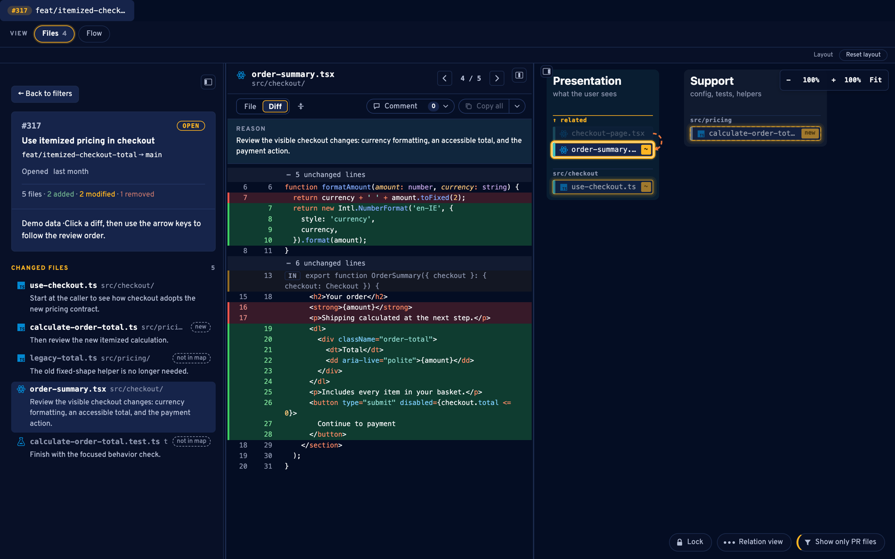

<p align="center">
  
</p>

<h1 align="center">Lantern</h1>

<p align="center">
  <strong>Your project, your codebase, is the whole context for your AI.</strong><br>
  Manage that context well. Lantern will help you with that.
</p>

<p align="center">
  Lantern maps your project, helps you plan changes, reviews pull requests with generated flows
  and local review, and keeps your AI assistant sessions across your harness
  together in one desktop app.
</p>

<p align="center"><a href="https://thelantern.dev">Website</a> · <a href="https://docs.thelantern.dev">Documentation</a></p>

<p align="center">
  <a href="https://github.com/MobileReality/lantern/actions/workflows/ci.yml"></a>
  <a href="LICENSE"></a>
  <a href="https://github.com/MobileReality/lantern/releases"></a>
</p>

## What it does

- **Watches every session** across your harness and shows a live dashboard of
  each one: its project, state, and last reply.
- **Notifies you** in the menu bar and with native notifications when a session **finishes**,
  **needs approval**, or is **waiting for input**, so you don't babysit a window.
- **Maps your project** into a `.lantern/` folder (one record per file, its role, its purpose and
  its relations) and draws it as a graph, so you can see the structure without reading the code.
- **Reviews pull requests and local changes** with a file list, diffs and the graph, in review
  order, with a reason for each changed file.
- **Local review**: review your uncommitted changes, or a branch with no pull request, with the
  same file list, diffs and graph as a pull request (**+ Compare** in the Lantern tab, or
  `lantern --compare`). One click asks Claude for a one-sentence reason per changed file.
- **Generate with Claude or Codex**: choose the assistant used by Lantern's maps
  and repairs for each project. This setting does not change the assistant inside the embedded
  editor. Pick the output **language per project** and repair broken output in place.

Sessions are told apart by their working directory: one entry per VS Code project window.

<p align="center">
  <br>
  <sub>A short tour (<a href="docs/assets/readme/lantern-tour.mp4">mp4, 70 s</a>). The screenshots show a synthetic demo project.</sub>
</p>

### The map of a project

Every file with its role, purpose and relations, drawn as a graph. The changed files of a pull
request are lit in it.



The macro view folds the same map into one card per area, with the systems the code talks to.



### Planning a change

A plan is a file under `.lantern/plans/`, written against the map and approved section by section.
Lantern shows its goal, scope, stages, open questions and the progress of every item, which comes
from the pull requests that tick it. Pick a stage and the areas, features and files it changes are
marked on the map; open a pull request from an item to review it.



### Reviewing a pull request

A flow in plain words says who does what and what changed, with the files that carry each step.



Then the diffs, in review order, each with the reason the file changed and its place in the graph.
With the flow on, the step the file belongs to is lit next to the code.





## Download

Packages are attached to each release on the
[releases page](https://github.com/MobileReality/lantern/releases): `Lantern-mac.zip` for
Apple-silicon Macs, `Lantern-win-x64.zip` for Windows and `Lantern-linux-x64.zip` for 64-bit Linux
(Linux packages are x64 only). The Apple-silicon build is also published
as `Lantern-mac-arm64.zip` for the updater, and the `Lantern-mac.zip` link stays the one to use. Until a release is published there,
build Lantern from source ([installation](docs/installation.md#install-and-run-from-source)).

The macOS app of a release built by the current workflow is signed with a Developer ID certificate
and notarized by Apple, so macOS only asks once to confirm opening it. Earlier releases are signed
ad hoc and need the steps in
[CONTRIBUTING.md](CONTRIBUTING.md#producing-a-build-to-share-distshare). The Windows build is not
code-signed, so SmartScreen may warn on first launch.

Verify the download: every release carries a `SHA256SUMS` file. Put it next to the zips you
downloaded and run `sha256sum -c SHA256SUMS --ignore-missing` on Linux or
`shasum -a 256 -c SHA256SUMS --ignore-missing` on macOS; each zip should print `OK`.

The Linux build is x64 only and unsigned. Extract it, make the binary executable and run it:

```bash
unzip Lantern-linux-x64.zip
cd Lantern-linux-x64
chmod +x Lantern
./Lantern
```

Chromium's sandbox needs unprivileged user namespaces or a setuid helper. Ubuntu 24.04 and newer
restrict user namespaces, so on such a system the app can exit at start with "The SUID sandbox
helper binary was found, but is not configured correctly". Fix it once with
`sudo chown root:root chrome-sandbox && sudo chmod 4755 chrome-sandbox` in the extracted folder,
or start the app with `./Lantern --no-sandbox`, which switches the sandbox off for that run. The
Linux build is new: CI builds it on Ubuntu but never runs it, and the memory view still says
"Not supported yet" there.

## Documentation

The documentation is at https://docs.thelantern.dev and in [docs/](docs/index.md):

- [Installation and command line](docs/installation.md)
- [Data and privacy](docs/installation.md#data-and-privacy): what Lantern stores, how to remove it, and what leaves your machine
- [Getting started](docs/getting-started.md)
- [Architecture](docs/architecture.md)
- Product overview: [thelantern.dev](https://thelantern.dev)

## Development and checks

The checks CI runs on every push and pull request (`.github/workflows/ci.yml`, a plain Linux
runner with Node 22, pnpm 10.28.0 and `pnpm install --frozen-lockfile`) are:

```bash
pnpm run typecheck
pnpm run lint        # biome lint --diagnostic-level=error
pnpm test
```

CI runs the unit tests, builds on Linux, macOS and Windows, runs the Playwright e2e for integrations,
the tray, pull request host state and skills (the graph suite is not run in CI), and publishes a coverage
report as a build artifact. It signs nothing. The stack, the project
layout, the code and testing conventions and the build pipeline are in
[CONTRIBUTING.md](CONTRIBUTING.md); a map of the source is in [docs/architecture.md](docs/architecture.md).

## More

- [CONTRIBUTING.md](CONTRIBUTING.md): how to work on the app, test it and build it.
- [SECURITY.md](SECURITY.md): how to report a vulnerability.
- [CODE_OF_CONDUCT.md](CODE_OF_CONDUCT.md): how we expect people to behave in this project.
- [TROUBLESHOOTING.md](TROUBLESHOOTING.md): known problems and their fixes.
- [THIRD_PARTY_NOTICES.md](THIRD_PARTY_NOTICES.md): licences of the software Lantern ships.

## License

Lantern is released under the MIT License. Copyright (c) 2026 Mobile Reality. See [LICENSE](LICENSE).
Contact: hello@themobilereality.com.

Lantern is not affiliated with or endorsed by Anthropic, OpenAI, Microsoft, Atlassian or GitHub; their names and marks are trademarks of their owners.

Made with &lt;love&gt; by People with AI  
By Mobile Reality
